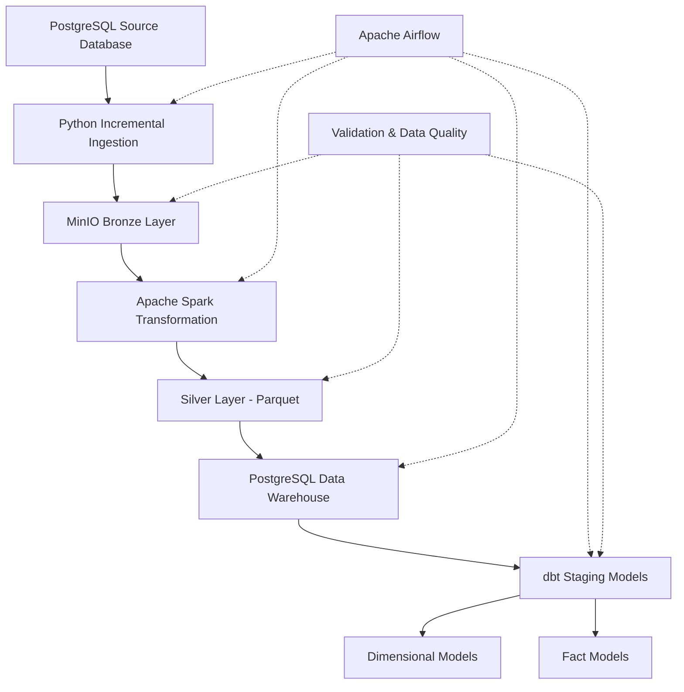

# E-Commerce Data Platform

**End-to-End Data Engineering Project | Batch & Incremental Data Processing**

An end-to-end data engineering platform that ingests e-commerce transactional data from PostgreSQL, processes it through Bronze and Silver data layers, loads curated data into a PostgreSQL data warehouse, and builds analytical models using dbt.

The project focuses on **data reliability, incremental processing, recoverability, transactional consistency, and data quality**.

## 1. Project Overview

This project simulates an e-commerce data platform handling six core business entities:

- Customers
- Products
- Orders
- Order Items
- Payments
- Shipments

The platform demonstrates the development of a data pipeline from source data generation to analytics-ready dimensional and fact models.

**Key engineering objectives:**

- Build reproducible local data infrastructure using Docker.
- Implement incremental data ingestion with checkpoint and watermark tracking.
- Store raw data in a MinIO-based Bronze layer.
- Transform and validate data using Apache Spark.
- Load processed data into a PostgreSQL warehouse.
- Build analytical models using dbt.
- Support recovery, rollback, and controlled write operations.

## 2. System Architecture



**Data flow:**

`PostgreSQL → Incremental Ingestion → MinIO Bronze → Spark Silver → PostgreSQL Warehouse → dbt Analytics`

Apache Airflow orchestrates the pipeline, while validation and checkpoint mechanisms help protect data consistency.

## 3. Technology Stack

| Technology | Purpose |
|---|---|
| Python | Data generation, ingestion, orchestration logic |
| PostgreSQL | Transactional source and data warehouse |
| Apache Airflow | Workflow orchestration |
| Apache Spark | Distributed data transformation |
| MinIO | S3-compatible object storage |
| Parquet | Columnar Silver-layer storage |
| dbt | SQL transformations, dimensional modeling, testing |
| Docker Compose | Local infrastructure management |
| pytest | Automated testing |
| Git & GitHub | Version control and project documentation |

## 4. Data Pipeline

### 4.1 Source Data Generation

Python scripts generate synthetic e-commerce records, including customers, products, orders, order items, payments, and shipments.

Source files are located in:

`source/generator/`

Database schema definitions are maintained in:

`source/database/`

### 4.2 Incremental Ingestion

The ingestion framework extracts data from PostgreSQL and uploads batches to MinIO.

It includes:

- Incremental extraction using watermarks.
- Batch metadata and checkpoint management.
- Recovery of incomplete ingestion operations.
- Explicit write permissions.
- DRY_RUN support for safe execution.

Implementation:

`ingestion/incremental/`

Airflow DAG:

`airflow/dags/ecommerce_incremental_ingestion.py`

### 4.3 Bronze Layer

The Bronze layer preserves ingested source records in MinIO.

Batch metadata and manifests support traceability and downstream processing.

### 4.4 Silver Layer

Apache Spark transforms Bronze records into structured Parquet datasets.

Transformation modules cover all six business entities.

Implementation:

`transformation/`

Validation contracts:

`validation/contracts/silver.yml`

### 4.5 Data Warehouse

Processed Silver data is loaded incrementally into PostgreSQL.

The warehouse loading framework includes:

- Incremental batch processing.
- Raw-table upsert operations.
- Checkpoint tracking.
- Transaction rollback protection.
- Recovery-oriented orchestration.

Implementation:

`warehouse/loader/`

## 5. Analytics Modeling with dbt

The dbt project is located at:

`warehouse/ecommerce_dbt/`

### Staging Models

Staging models standardize warehouse source data for downstream analytical transformations.

### Dimension Models

| Model | Description |
|---|---|
| `dim_customers` | Customer dimension |
| `dim_products` | Product dimension |
| `dim_date` | Date dimension |

### Fact Models

| Model | Description |
|---|---|
| `fact_orders` | Order-level facts |
| `fact_order_items` | Order-item facts |
| `fact_payments` | Payment facts |
| `fact_shipments` | Shipment facts |

dbt model configuration and data tests are maintained alongside SQL models in YAML files.

## 6. Data Reliability & Recovery

Reliability is a central focus of this project.

**Incremental ingestion recovery**

Batch tracking and recovery logic help resume processing when ingestion operations are interrupted.

**Checkpoint consistency**

Watermark and checkpoint management prevent incomplete batches from being treated as successfully processed.

**Transactional warehouse loading**

Warehouse operations use transaction boundaries to protect data consistency when a batch fails.

**Write safety**

The incremental Airflow DAG defaults to `DRY_RUN`.

WRITE mode requires explicit table selection and appropriate environment permissions, including:

- `INGESTION_WRITE_ENABLED=true`
- `WAREHOUSE_WRITE_ENABLED=true`

These controls are intended to prevent accidental data modifications during development and testing.

## 7. Testing & Validation

The repository contains automated tests for:

- Incremental extraction.
- Batch repository behavior.
- Watermark management.
- Checkpoint commits.
- Recovery and retry scenarios.
- Staging operations.
- Write safety.
- Warehouse atomic rollback.
- Warehouse checkpoint failure rollback.
- Warehouse upsert rollback.

**Validated project milestones:**

| Validation | Result |
|---|---|
| Ingestion recovery integration checks | PASS — 8/8 |
| dbt data tests | PASS — 148/148 |
| Controlled end-to-end WRITE pipeline | PASS |

These results represent completed development validation runs rather than a continuous production monitoring guarantee.

## 8. Project Structure

```text
ecommerce-data-platform/
├── airflow/              # Airflow DAGs and Docker configuration
├── docs/                 # Operational documentation
├── ingestion/            # Batch and incremental ingestion
├── source/               # PostgreSQL schema and data generators
├── spark/                # Spark runtime configuration
├── tests/                # Automated tests
├── transformation/       # Bronze-to-Silver transformations
├── validation/           # Data quality checks and contracts
├── warehouse/
│   ├── loader/           # Incremental warehouse loading
│   ├── ecommerce_dbt/    # dbt analytical models
│   ├── dbt.Dockerfile
│   └── dbt_profiles/
├── .env.example          # Environment configuration template
└── docker-compose.yml    # Local infrastructure
```

## 9. Getting Started

### Prerequisites

- Docker Desktop with Docker Compose
- Git
- Python
- PowerShell or a compatible terminal

### Clone the Repository

```bash
git clone https://github.com/lephuocyen20/ecommerce-data-platform.git
cd ecommerce-data-platform
```

### Configure Environment Variables

Create a local `.env` file based on `.env.example`.

```powershell
Copy-Item .env.example .env
```

Replace example values with your own credentials and review the database, MinIO, and Airflow configuration before starting the services.

**Never commit `.env` or real credentials to version control.**

### Start Infrastructure

```powershell
docker compose up -d postgres minio
```

Initialize Airflow when setting up the environment for the first time:

```powershell
docker compose run --rm airflow-init
```

Start the Airflow services:

```powershell
docker compose up -d airflow-api-server airflow-scheduler airflow-dag-processor
```

Check service status:

```powershell
docker compose ps
```

### Airflow DAGs

| DAG | Purpose | Schedule |
|---|---|---|
| `ecommerce_pipeline` | Existing batch pipeline | `0 19 * * *` |
| `ecommerce_incremental_ingestion` | Incremental ingestion and downstream processing | Manual |
| `dockeroperator_runtime_probe` | Docker runtime verification | Manual |

The incremental DAG defaults to `DRY_RUN`. WRITE execution requires explicit configuration and should only be enabled after reviewing the operational runbook.

For additional operational guidance, see [RUNBOOK.md](docs/RUNBOOK.md).

## 10. Future Improvements

Potential next steps include:

- Analytics dashboard development.
- Streaming ingestion and near-real-time processing.
- CI/CD automation.
- Automated observability and alerting.
- Performance benchmarking.
- Cloud deployment.

## 11. Project Status

The project has completed a controlled end-to-end batch and incremental processing workflow, including ingestion, transformation, warehouse loading, dbt modeling, and associated validation.

The current implementation is intended as a practical, locally reproducible Data Engineering portfolio project.

---

**Project focus:** Building reliable, recoverable, and testable data pipelines using open-source data engineering technologies.