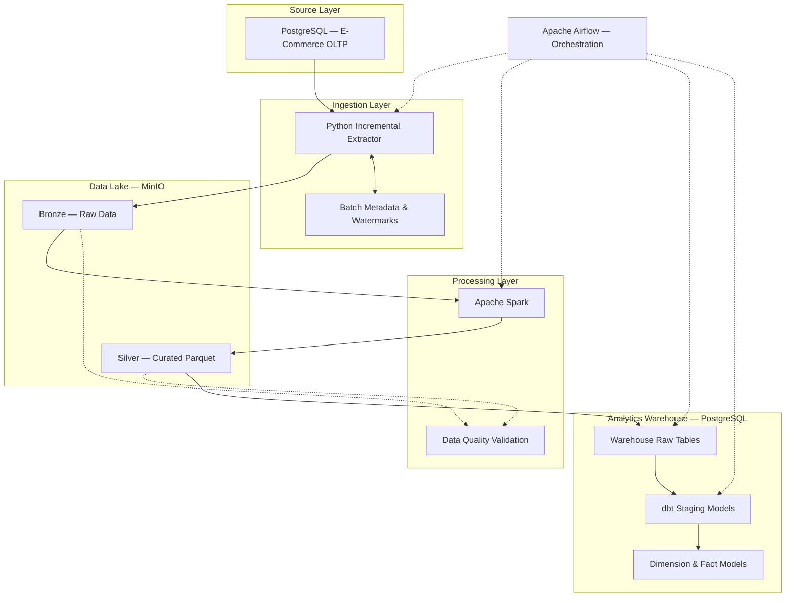
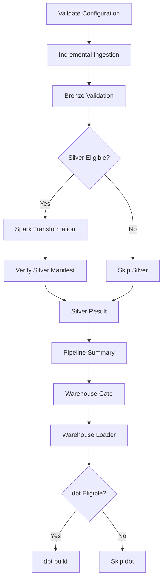

# E-Commerce Data Platform — System Architecture

## 1. Overview

The E-Commerce Data Platform is a local, containerized data engineering system designed to demonstrate reliable batch and incremental processing of transactional e-commerce data.

The platform processes six business entities: customers, products, orders, order items, payments, and shipments.

Its architecture separates data ingestion, storage, transformation, warehouse loading, and analytical modeling into distinct stages.

The primary engineering goals are:

- Incremental data processing
- Data quality enforcement
- Recoverability after failures
- Transactional consistency
- Controlled and auditable execution
- Modular pipeline development

## 2. High-Level Architecture

The architecture uses PostgreSQL as both the transactional source and analytical warehouse in the local environment, while maintaining logical separation between their responsibilities.

## 3. Source Layer

The source database represents an e-commerce transactional system.

Its core tables are:

| Table | Business Purpose |
|---|---|
| customers | Customer information |
| products | Product catalog and inventory |
| orders | Customer orders |
| order_items | Products associated with orders |
| payments | Payment transactions |
| shipments | Order delivery information |

Synthetic data is generated through Python scripts located in `source/generator/`.

Database schema and seed scripts are maintained in `source/database/`.

## 4. Incremental Ingestion Architecture

The incremental ingestion framework is implemented in `ingestion/incremental/`.

Its responsibilities include extracting source records, managing incremental processing state, uploading data to MinIO, and supporting recovery after interrupted operations.

### 4.1 Watermark Tracking

Watermarks represent the processing position used to identify data eligible for incremental extraction.

This reduces the need to repeatedly extract an entire source table.

### 4.2 Batch Metadata

Batch metadata records information associated with an ingestion operation.

The metadata is used to distinguish processing attempts, track batch progress, and support recovery.

### 4.3 Recovery

The ingestion framework contains recovery logic for incomplete batches.

Recovery operations are designed to verify previously persisted data and metadata before advancing processing state.

### 4.4 Write Safety

The Airflow incremental DAG defaults to `DRY_RUN`.

WRITE execution requires explicit table selection and the environment permission `INGESTION_WRITE_ENABLED=true`.

These safeguards reduce the risk of accidental writes during development and operational verification.

## 5. Bronze Layer

The Bronze layer stores ingested source data in MinIO, an S3-compatible object storage system.

It acts as the landing zone between source extraction and downstream transformation.

Batch manifests provide references to the files associated with processing operations.

The separation between Bronze storage and downstream processing helps isolate ingestion concerns from transformation concerns.

## 6. Silver Layer

Apache Spark transforms Bronze records into curated Parquet datasets in the Silver layer.

Transformation logic is organized by business entity under `transformation/transforms/`.

The pipeline also includes validation mechanisms for:

- Schema consistency
- Data quality rules
- Foreign-key relationships
- Data contracts

Silver data quality contracts are maintained in `validation/contracts/silver.yml`.

The incremental Airflow DAG contains separate transformation, verification, and skip paths for individual tables.

## 7. Warehouse Loading

The warehouse loading framework is implemented in `warehouse/loader/`.

It transfers processed Silver data into PostgreSQL warehouse tables.

### 7.1 Incremental Loading

Incremental loading processes eligible data batches instead of requiring a full warehouse reload for every execution.

### 7.2 Upsert Operations

Warehouse loading includes upsert logic for handling records that must be inserted or updated.

### 7.3 Transactional Consistency

Warehouse operations use database transaction boundaries to protect against partially committed processing states.

Rollback tests cover several failure scenarios, including:

- Atomic batch rollback
- Checkpoint failure rollback
- Upsert update rollback

### 7.4 Warehouse Write Guard

Warehouse write operations are protected by `WAREHOUSE_WRITE_ENABLED=true`.

The Airflow DAG includes a warehouse gate before invoking the loading task.

## 8. Analytical Modeling with dbt

The dbt project is located in `warehouse/ecommerce_dbt/`.

It contains two main modeling layers.

### 8.1 Staging

Staging models prepare warehouse data for downstream analytical transformations.

The staging layer covers all six source entities.

### 8.2 Data Marts

**Dimensions**

- `dim_customers`
- `dim_products`
- `dim_date`

**Facts**

- `fact_orders`
- `fact_order_items`
- `fact_payments`
- `fact_shipments`

These models form the analytical layer of the platform.

dbt tests validate defined model constraints and data quality expectations.

## 9. Airflow Orchestration

Apache Airflow coordinates pipeline execution.

The repository includes two principal processing DAGs:

| DAG | Purpose | Schedule |
|---|---|---|
| `ecommerce_pipeline` | Original batch pipeline | `0 19 * * *` |
| `ecommerce_incremental_ingestion` | Controlled incremental pipeline | Manual |

### 9.1 Incremental DAG Execution Flow

The actual DAG expands ingestion and Silver processing into table-specific tasks and consolidates their results before warehouse processing.

### 9.2 dbt Execution

The incremental DAG uses an Airflow DockerOperator to run dbt.

The Docker image is:

`ecommerce-data-platform-dbt-runner:latest`

The operator executes:

`dbt build`

The dbt project and profiles are mounted into the container, while database connection settings are supplied through environment variables.

## 10. Data Reliability and Failure Handling

The platform applies reliability controls at multiple processing stages.

| Layer | Reliability Mechanism |
|---|---|
| Ingestion | Incremental checkpoints, batch metadata, recovery |
| Bronze | Batch manifests and object verification |
| Silver | Validation and manifest verification |
| Warehouse | Transaction boundaries, rollback, checkpoint handling |
| dbt | Model-level tests and controlled execution |
| Airflow | Task state tracking, branching, retries and write guards |

These mechanisms are intended to reduce inconsistent processing states and improve recoverability.

They do not eliminate the need for operational monitoring or backups.

## 11. Design Decisions and Trade-offs

### PostgreSQL as Source and Warehouse

**Benefit:** Simplifies local infrastructure and makes the project reproducible without a managed cloud warehouse.

**Trade-off:** The implementation does not demonstrate the scalability characteristics of a dedicated cloud analytical warehouse.

### MinIO for Data Lake Storage

**Benefit:** Provides S3-compatible storage for local development.

**Trade-off:** Production deployments require additional considerations for durability, security, access control and infrastructure operations.

### Apache Spark for Transformation

**Benefit:** Demonstrates distributed data processing concepts and Parquet-based transformation.

**Trade-off:** Spark introduces additional runtime overhead for relatively small local datasets.

### dbt for Analytics

**Benefit:** Separates SQL analytical modeling from ingestion and storage operations.

**Trade-off:** dbt model execution depends on the availability and consistency of upstream warehouse data.

### Controlled WRITE Execution

**Benefit:** Explicit write permissions and DRY_RUN reduce the risk of unintended data modification.

**Trade-off:** Additional configuration and validation steps are required before executing write operations.

## 12. Validation Results

Completed development validation milestones include:

| Validation | Recorded Result |
|---|---|
| Ingestion recovery integration checks | PASS — 8/8 |
| dbt data tests | PASS — 148/148 |
| Controlled end-to-end WRITE pipeline | PASS |

These results reflect previously completed development tests, not a guarantee of continuous production reliability.

## 13. Current Scope and Future Evolution

The current project demonstrates an end-to-end local batch and incremental data engineering workflow.

Potential future extensions include:

- Streaming ingestion
- Analytics dashboards
- CI/CD pipelines
- Centralized observability and alerting
- Cloud-native deployment
- Performance and scalability benchmarking

---

For operational instructions, refer to [RUNBOOK.md](RUNBOOK.md).

For the project overview, refer to [README.md](../README.md).
